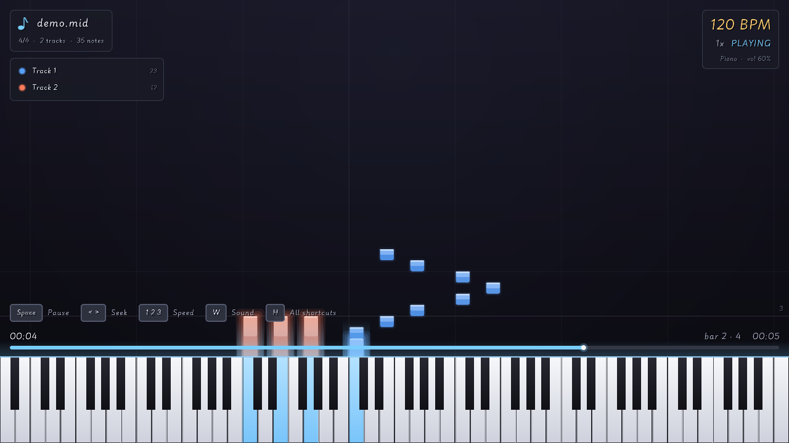
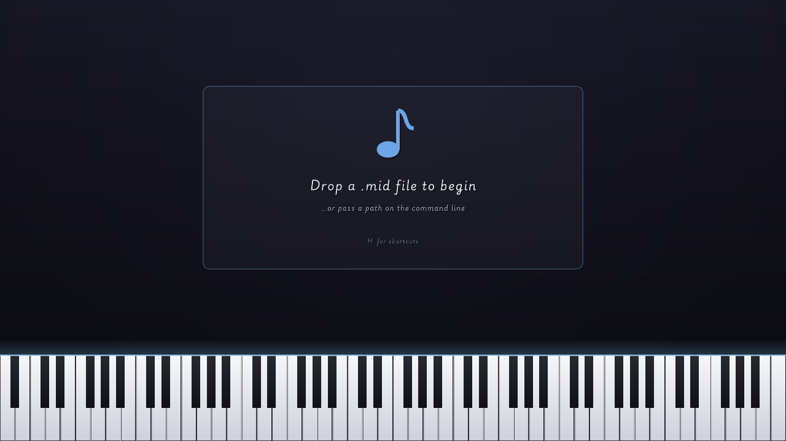
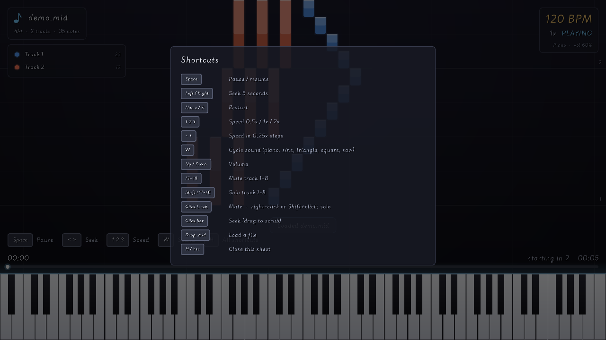

# Klavrasa

A MIDI piano-roll visualizer written in [Odin](https://odin-lang.org/) using [Raylib](https://www.raylib.com/).

Klavrasa loads Standard MIDI Files and renders them as a falling-note piano roll
with real-time audio playback from a small built-in synthesizer. The MIDI parser
is written from scratch — no external MIDI libraries.



## Features

- Falling-note piano roll over an 88-key keyboard, colour-coded per track
- Beat and bar grid that follows every time-signature change, with bar numbers
- Tempo map (tempo changes are honoured; the live BPM is shown on screen)
- Built-in polyphonic synth with five sounds — piano, sine, triangle, square,
  saw — each with its own ADSR envelope; square/saw are band-limited (PolyBLEP)
- Track panel with per-track mute and solo; muted parts stay visible as ghosts
- Seek anywhere: click or drag the progress bar, or step with the arrow keys
- Key signature, time signature and track names read from the file

## Requirements

- [Odin compiler](https://odin-lang.org/docs/install/) (the `vendor:raylib`
  bindings ship with Odin, so Raylib needs no separate install)
- A desktop OS with OpenGL (developed on Linux / Arch)

## Build & Run

```sh
# Run directly (compiles to a temp binary, then runs)
odin run .

# …optionally with a file to load on startup
odin run . -- song.mid

# Or build a standalone binary
odin build . -out:klavrasa
./klavrasa song.mid
```

Once the window is open, **drag and drop** any `.mid` file onto it to load it.
A summary of the parsed file (format, division, tracks, note counts, tempo) is
printed to the console — handy for verifying the parser against real files.

> **Arch Linux: `cannot find -l:/usr/lib/odin/vendor/raylib//linux/libraylib.so.600`**
>
> Odin's raylib bindings link against `libraylib.so.600` (raylib 6.0), which the
> `odin` package symlinks to `/usr/lib/libraylib.so.600`. When the system
> `raylib` package is newer (e.g. 6.2 ships `libraylib.so.620`), that symlink is
> dangling and linking fails. Point it at the installed library:
>
> ```sh
> sudo ln -sf /usr/lib/libraylib.so.620 /usr/lib/libraylib.so.600
> ```
>
> (Adjust `620` to whatever `ls /usr/lib/libraylib.so.*` shows.) Updating `odin`
> to a release built against the same raylib version also fixes it.

Two example files are included:

```sh
odin run . -- assets/demo.mid    # 2-track melody + chords (good first look)
odin run . -- assets/sample.mid  # minimal 2-note file
```

## Screenshots

| Start screen | Shortcut sheet (`H`) |
|:---:|:---:|
|  |  |

## Controls

| Key / mouse         | Action                                        |
|---------------------|-----------------------------------------------|
| `Space`             | Pause / resume                                |
| `←` `→`             | Seek 5 seconds back / forward                 |
| click / drag bar    | Seek to that point                            |
| `Home` / `R`        | Restart from the beginning                    |
| `1` `2` `3`         | 0.5× / 1× / 2× speed                          |
| `-` `+`             | Speed in 0.25× steps (0.25×–4×)               |
| `W`                 | Cycle sound: piano, sine, triangle, square, saw |
| `↑` `↓`             | Volume                                        |
| click track row     | Mute / unmute that track                      |
| right-click row     | Solo that track (also `Shift`+click)          |
| `F1`–`F8`           | Mute track 1–8 (`Shift` to solo)              |
| `H`                 | Show all shortcuts                            |
| drag/drop           | Load another `.mid`                           |

Playback loops automatically at the end. The speed multiplier changes tempo,
not pitch.

## Testing

The MIDI parser has a unit-test suite (hand-built byte streams covering tempo
meta events, running status, note-on-velocity-0, SMPTE division, and malformed
headers):

```sh
odin test .
```

## Project structure

```
klavrasa/
├── main.odin        # entry point, playback engine, controls
├── midi.odin        # MIDI binary parser (Format 0 & 1)
├── midi_test.odin   # parser unit tests
├── timeline.odin    # tick→seconds tempo map, note + event extraction
├── piano_roll.odin  # falling-note rendering + 88-key keyboard
├── audio.odin       # sine-wave synthesis + polyphonic mixing
├── ui.odin          # BPM display, speed/pause overlay, progress bar
├── docs/screenshots # images used in this README
└── assets/
    ├── demo.mid     # 2-track melody + chords
    └── sample.mid   # minimal 2-note file
```

## Roadmap

- [x] **MIDI parser** — Format 0/1, variable-length quantities, running status,
      note on/off, velocity, delta/absolute ticks, tempo & meta events, SysEx
- [x] **Piano-roll renderer** — falling note blocks, 88-key keyboard, per-octave shading
- [x] **Multi-track rendering** — one color per track, layered
- [x] **Audio playback** — sine-wave synthesis (equal temperament, A4 = 440 Hz), polyphonic mixing
- [x] **Playback controls** — 0.5×/1×/2× speed, pause/resume, BPM display
- [x] **Drag-and-drop** loading at runtime

## License

MIT
